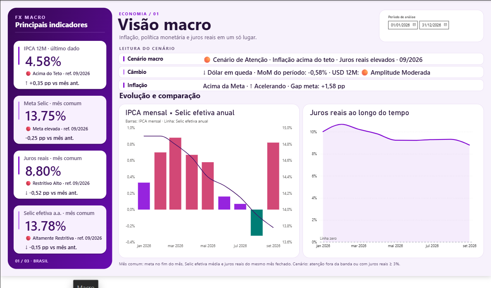
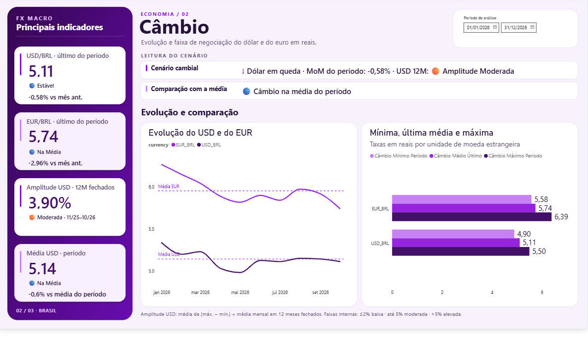
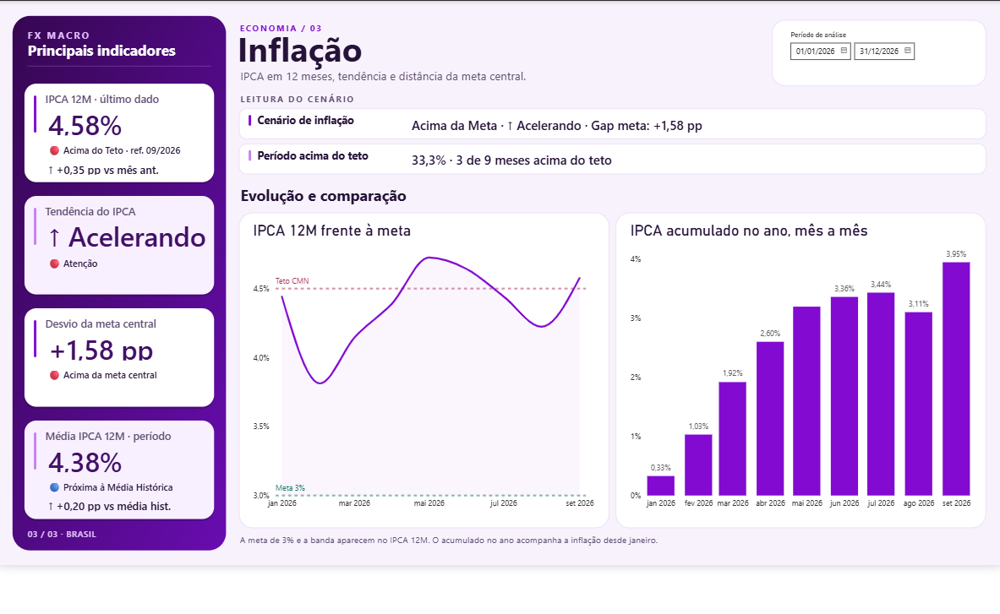
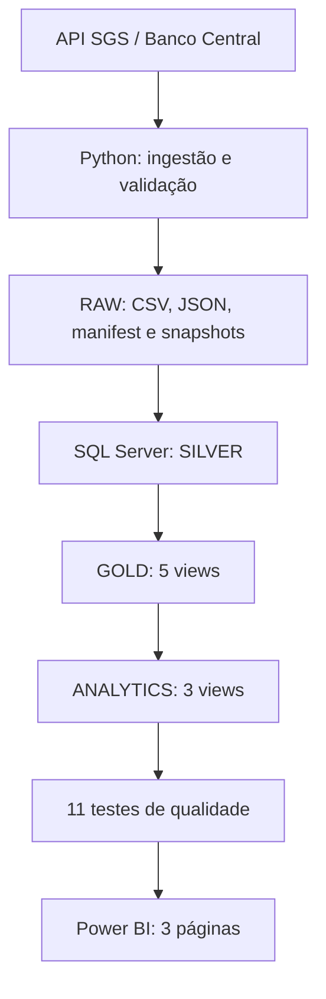

# FX Macro Analytics V2

**Pipeline de dados macroeconômicos do Banco Central do Brasil, desenvolvido com Python, SQL Server e Power BI.**

O projeto coleta séries públicas da API SGS/BCB, valida e organiza os dados em camadas analíticas e apresenta indicadores de **inflação, câmbio, política monetária e juros reais** em um dashboard de três páginas.

A V2 amplia a versão anterior com a **Meta SELIC (SGS 432)**, uma view GOLD dedicada, validações adicionais e uma revisão visual e analítica do relatório.

> **Estado da revisão:** execução integrada concluída em **09/11/2026**, com cinco séries carregadas, oito views SQL executadas e **11 de 11 verificações de qualidade aprovadas**. Os números abaixo são um registro dessa execução, não valores atualizados em tempo real.

## Visão geral

| Dimensão | Implementação |
| --- | --- |
| Fonte | Banco Central do Brasil — API SGS |
| Ingestão e transformação | Python, Pandas, Requests e SQLAlchemy |
| Armazenamento analítico | Microsoft SQL Server |
| Camadas | RAW → SILVER → GOLD → ANALYTICS |
| Visualização | Microsoft Power BI / DAX |
| Qualidade | Contratos de entrada, SHA-256, testes SQL e transação de carga |
| Execução | Manual, por PowerShell, com opção de atualizar a API |

## Dashboard Power BI

### 01 — Visão Macro

Consolida IPCA acumulado em 12 meses, **Meta SELIC**, SELIC efetiva anualizada e juros reais. Os indicadores de política monetária usam um **mês de referência comum** quando apresentados lado a lado; o gráfico combina IPCA mensal e SELIC efetiva em eixos separados.



### 02 — Câmbio

Apresenta USD/BRL e EUR/BRL, evolução das médias mensais, comparação entre mínima/média/máxima e uma medida exploratória de **amplitude do USD em 12 meses fechados**.



### 03 — Inflação

Compara o **IPCA em 12 meses** com a meta central de **3%** e o teto de **4,5%**, além de exibir a tendência, o desvio da meta, a proporção de meses acima do teto e o IPCA acumulado no ano. O acumulado no ano é mostrado separadamente, sem ser tratado como a métrica oficial de cumprimento da meta anual.



> As imagens representam a versão do relatório exibida em novembro de 2026. O arquivo Power BI precisa ser atualizado manualmente para refletir novas cargas no SQL Server.

## Arquitetura



**RAW:** a ingestão gera CSVs normalizados, mantém respostas JSON e preserva snapshots identificados por `run_id` em `data/RAW/snapshots/`. O `manifest.json` registra metadados e hashes SHA-256; a carga verifica esses hashes antes de persistir os dados.

**SILVER:** IPCA, SELIC efetiva e Meta SELIC são carregados em `dbo.fx_macro_indicadores`. As séries cambiais são armazenadas em `silver.usd_brl` e `silver.eur_brl`.

**GOLD / ANALYTICS:** views SQL organizam séries mensais, inflação acumulada, câmbio e juros reais para consumo no Power BI.

**Consistência:** `run_all.py` executa carga, criação/atualização de views e validação **na mesma transação SQL**. Se essa etapa falhar, a transação é revertida. A consulta à API e a publicação dos arquivos RAW ocorrem **fora** dessa transação.

## Séries utilizadas

| Indicador | Código SGS | Frequência configurada | Uso principal |
| --- | ---: | --- | --- |
| IPCA | `433` | Mensal | Inflação, IPCA 12M e acumulado anual |
| USD/BRL | `1` | Diária | Câmbio do dólar |
| EUR/BRL | `21619` | Diária | Câmbio do euro |
| SELIC efetiva anualizada | `1178` | Diária | Política monetária e juros reais |
| Meta SELIC (Copom) | `432` | Diária | Taxa-alvo anual e comparação com a efetiva |

A frequência diária da Meta SELIC indica a frequência das observações da série; **não** significa que o Copom altera a meta diariamente.

### Views SQL

**GOLD (`sql/GOLD/`):**

- `dbo.vw_gold_ipca`
- `dbo.vw_gold_selic`
- `dbo.vw_gold_macro`
- `dbo.vw_macro_monthly`
- `dbo.vw_gold_selic_meta` **(nova na V2)**

**ANALYTICS (`sql/ANALYTICS/`):**

- `dbo.vw_fx_monthly_summary`
- `dbo.vw_macro_ipca_12m`
- `dbo.vw_macro_real_rate`

## Como executar no Windows

### Pré-requisitos

- Python **3.10+**;
- SQL Server e acesso à instância via autenticação integrada do Windows;
- **ODBC Driver 17 for SQL Server**, ou outro driver configurado pela variável `FX_SQL_DRIVER`;
- Power BI Desktop, para abrir e atualizar o relatório.

### 1. Preparar o ambiente

No PowerShell, a partir da raiz do repositório:

```powershell
python -m venv .venv
.\.venv\Scripts\Activate.ps1
python -m pip install -r requirements.txt
```

### 2. Configurar a conexão

```powershell
$env:FX_SQL_SERVER = 'SEU_COMPUTADOR\SQLEXPRESS'
$env:FX_SQL_DATABASE = 'fx_macro_revisao'
# Opcional, caso utilize outro driver:
# $env:FX_SQL_DRIVER = 'ODBC Driver 18 for SQL Server'
```

Para a primeira execução, recomenda-se **um banco de desenvolvimento separado**, sem apontar diretamente para um banco existente em produção. No SSMS, com as permissões necessárias:

```sql
CREATE DATABASE fx_macro_revisao;
```

Confirme que o terminal está conectado à instância e ao banco esperados. O bootstrap cria estruturas ausentes, mas não corrige automaticamente esquemas antigos incompatíveis.

### 3. Inicializar e executar

```powershell
# Preparar as estruturas SQL necessárias
python src/transformation/bootstrap_db.py

# Coletar as cinco séries na API e executar a carga/validação
python src/transformation/run_all.py --refresh

# Reexecutar a carga a partir dos arquivos RAW já publicados
python src/transformation/run_all.py
```

O parâmetro `--legacy-snapshot` permite dispensar o manifest de um conjunto antigo de CSVs, **mas não dispensa a presença das cinco séries atualmente configuradas**. Snapshots de versões anteriores que contenham apenas quatro séries precisam ser adaptados antes da carga.

A coleta diária solicita aproximadamente **3.650 dias** de histórico por série; o IPCA é consultado conforme sua frequência mensal. Caso a API rejeite uma janela, o tratamento correto é revisar a consulta ou implementar particionamento, não ignorar a falha.

### 4. Atualizar o Power BI

Abra o `.pbix`, confirme o servidor e o banco SQL Server nas configurações de origem de dados e clique em **Atualizar**. A atualização do Power BI é **manual** nesta versão; não há implantação cloud, agendamento ou atualização automática no Power BI Service implementados no projeto.

## Indicadores e regras de negócio

| Indicador | Interpretação |
| --- | --- |
| **IPCA 12M** | Acumulado composto de 12 meses; comparado à meta central e ao teto |
| **IPCA acumulado no ano** | Inflação acumulada desde janeiro, apresentada separadamente do IPCA 12M |
| **Meta SELIC** | Taxa-alvo da série SGS 432; nos cartões comparativos, usa a referência mensal comum |
| **SELIC efetiva** | Série SGS 1178, anualizada em base 252; agregação mensal mantém a unidade `% a.a.` |
| **Juros reais** | Indicador ex post baseado na composição de fatores; não representa projeção de juros futuros |
| **Variação mensal** | Diferença em **pontos percentuais** para taxas e variação percentual para câmbio, conforme a medida |
| **Amplitude cambial USD 12M** | Média, em 12 meses fechados, de `(máxima mensal − mínima mensal) ÷ média mensal` |

A classificação da amplitude cambial usada no dashboard é **exploratória**: abaixo de 2% = baixa; de 2% até 5% = moderada; acima de 5% = elevada. **Amplitude não equivale à volatilidade estatística** (por exemplo, desvio-padrão de retornos).

As classificações textuais do cenário macroeconômico e dos juros são **regras analíticas do relatório**, não classificações oficiais do Banco Central. Para comparar Meta SELIC, SELIC efetiva e juros reais, a página Visão Macro explicita o mês comum de referência.

Documentação complementar de contratos e unidades: [docs/METRICAS.md](docs/METRICAS.md).

## Qualidade de dados e validação

A carga verifica colunas obrigatórias, tipos, datas, duplicidades, valores inválidos, metadados de série e integridade SHA-256 dos CSVs.

A consulta `sql/Validation/validate_gold.sql`, executada por `src/transformation/run_validation.py`, contém **11 testes**:

| Teste | Verificação |
| --- | --- |
| `GOLD_VAZIA` | View mensal sem registros |
| `IPCA_INVALIDO` | Valores ou datas inválidos de IPCA |
| `SELIC_INVALIDA` | Valores ou datas inválidos da SELIC efetiva |
| `SELIC_META_INVALIDA` | Ausência da série Meta SELIC ou valores/datas inválidos |
| `JUROS_REAIS_NULO` | Juros reais ausentes onde existe IPCA 12M |
| `DATA_DUPLICADA` | Datas mensais duplicadas na view macro |
| `DATA_NULA` | Datas nulas na view macro |
| `CAMBIO_VAZIO` | Ausência de dados nas tabelas cambiais |
| `LACUNA_IPCA` | Lacunas na sequência mensal de IPCA |
| `MOEDAS_AUSENTES` | Falta de uma das duas moedas na view cambial |
| `IPCA_12M_INVALIDO` | IPCA 12M ausente após o período mínimo de formação |

Para executar os testes Python locais:

```powershell
python -m unittest discover -s tests -v
```

Os testes unitários não substituem a integração real com SQL Server. Antes de publicar uma nova versão, verifique a idempotência de cargas sucessivas, a reversão da transação em caso de falha, os contratos das **oito views** e a conciliação dos indicadores no Power BI.

### Exemplo de execução validada — 09/11/2026

| Série | Observações conferidas |
| --- | ---: |
| IPCA | 561 |
| USD/BRL | 2.507 |
| EUR/BRL | 2.505 |
| SELIC efetiva | 2.507 |
| Meta SELIC | 3.651 |
| **Total** | **11.731** |

Resultado registrado no terminal: **5 views GOLD**, **3 views ANALYTICS**, **11 testes com zero erros** e confirmação da transação SQL.

## Limitações e cuidados

- A atualização do Power BI não é automatizada.
- A publicação dos arquivos RAW não participa da transação SQL; execute apenas uma instância do pipeline por vez.
- O histórico das séries diárias está limitado à janela solicitada na ingestão; a série IPCA segue outra abrangência temporal.
- Métricas de cenário, faixas de amplitude e sinais visuais dependem de regras definidas no dashboard e devem ser interpretadas com seu contexto.
- O README documenta a V2; mantenha também [docs/REVISAO.md](docs/REVISAO.md) e [docs/METRICAS.md](docs/METRICAS.md) sincronizados com o código e as medidas DAX atuais.

## Autor

**Pedro Henrique Oliveira Sousa**\
[GitHub](https://github.com/DevPh1) · [LinkedIn](https://www.linkedin.com/in/phos10/)

---

*Projeto de portfólio em Engenharia de Dados e Business Intelligence. Dados de origem pública: Banco Central do Brasil.*
